# Assignment 2 – Data Structures

**Course:** Design and Analysis of Algorithms  
**Instructor:** Taubakabyl Nurlybek

## 1. Complexity Analysis

### DynamicArray

| Operation | Best Case | Average Case | Worst Case | Auxiliary Space |
|---|---|---|---|---|
| add(x) | Θ(1) | Θ(1) amortized | Θ(n) | O(n) during resize |
| add(index, x) | Θ(1) | Θ(n) | Θ(n) | O(n) during resize |
| remove(index) | Θ(1) | Θ(n) | Θ(n) | Θ(1) |
| get(index) | Θ(1) | Θ(1) | Θ(1) | Θ(1) |
| contains(x) | Θ(1) | Θ(n) | Θ(n) | Θ(1) |

**Justification:** `add(x)` normally writes directly to the next free position, but resizing requires copying all existing elements. Insertion and removal may shift many array elements. Direct indexed access is constant time. Search is linear because elements may need to be checked one by one.

### MyLinkedList

| Operation | Best Case | Average Case | Worst Case | Auxiliary Space |
|---|---|---|---|---|
| add(x) | Θ(1) | Θ(1) | Θ(1) | Θ(1) |
| add(index, x) | Θ(1) | Θ(n) | Θ(n) | Θ(1) |
| remove(index) | Θ(1) | Θ(n) | Θ(n) | Θ(1) |
| get(index) | Θ(1) | Θ(n) | Θ(n) | Θ(1) |
| contains(x) | Θ(1) | Θ(n) | Θ(n) | Θ(1) |

**Justification:** The list keeps a tail reference, so appending is constant time. Operations at the head are also constant time, while operations at an arbitrary index require traversal through nodes. Search may inspect the whole list.

### MinHeap

| Operation | Best Case | Average Case | Worst Case | Auxiliary Space |
|---|---|---|---|---|
| insert(x) | Θ(1) | O(log n) | Θ(log n) | O(n) during resize |
| peekMin() | Θ(1) | Θ(1) | Θ(1) | Θ(1) |
| extractMin() | Θ(1) | O(log n) | Θ(log n) | Θ(1) |

**Justification:** `insert(x)` may stop immediately or bubble up through the height of the heap. `peekMin()` directly reads the root at index 0. `extractMin()` may require bubble-down from the root to a leaf.
## 2. Loop Invariant Proofs

### 2.1 DynamicArray.contains(x)

The `contains(x)` method checks the elements of the array from left to right until the value is found or all elements have been checked.

**Invariant:**  
Before every iteration with index `i`, none of the elements at positions `0` through `i - 1` is equal to the searched value.

**Initialization:**  
Before the first iteration, `i = 0`. No elements have been checked yet, so the range before index 0 is empty. Therefore, the invariant is true.

**Maintenance:**  
During an iteration, the method compares `data[i]` with the searched value. If they are equal, the method correctly returns `true`. If they are not equal, index `i` has also been checked and the loop continues with `i + 1`. Therefore, before the next iteration, all previously checked elements are known not to contain the searched value.

**Termination:**  
The loop stops in one of two cases. If an equal element is found, the method returns `true`. Otherwise, the loop ends when `i == size`, which means that every valid element of the array has been checked and none is equal to the searched value.

**Conclusion:**  
The invariant proves that `contains(x)` returns `true` exactly when the value exists in the DynamicArray and returns `false` when it does not.

### 2.2 MinHeap.bubbleDown()

The `bubbleDown()` operation restores the min-heap property after the root is replaced during `extractMin()`.

**Invariant:**  
Before every iteration, the heap property is valid everywhere except possibly between the node at the current `index` and its children. All other parts of the heap satisfy the condition that every parent is less than or equal to its children.

**Initialization:**  
After `extractMin()` moves the last element to the root, the two subtrees below the root are still valid min-heaps because their internal order was not changed. Only the new root may violate the heap property with its children. Therefore, the invariant is true before the first iteration.

**Maintenance:**  
During each iteration, the algorithm compares the current node with its left and right children and finds the smallest value. If one of the children is smaller, the current node is swapped with the smallest child. This fixes the heap property at the old position. The only possible violation is now at the new position of the moved element, so the invariant remains true for the next iteration.

**Termination:**  
The loop stops when the current node is already smaller than or equal to both children, or when it has no smaller child. At this point there is no remaining possible violation. Since all other parts of the heap already satisfied the heap property, the entire heap is valid.

**Conclusion:**  
The invariant shows that every iteration moves the possible violation downward without creating violations elsewhere. When `bubbleDown()` terminates, the complete min-heap property is restored.
## 3. Benchmark Results

The benchmark was executed for `n = 100, 1,000, 10,000, 100,000`.  
All input data was generated using `Random(42)` to make the experiment reproducible.  
Each case used one warm-up run followed by five measured runs, and the median execution time was saved to `results.csv`.

### W1 – Random Access

W1 performs 10,000 random `get(index)` operations on DynamicArray and MyLinkedList.

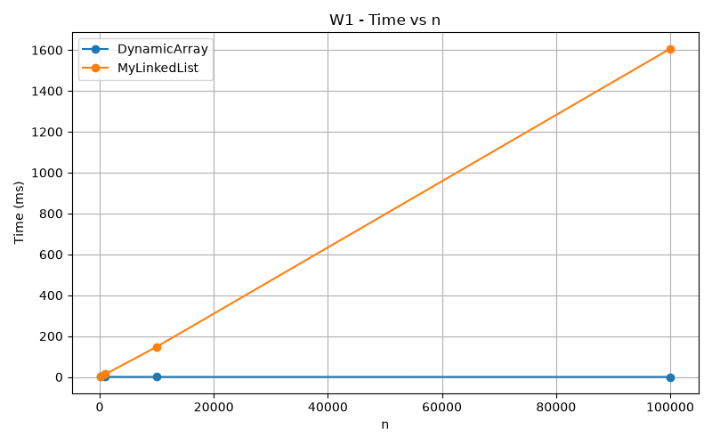

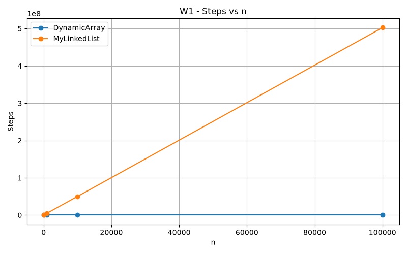
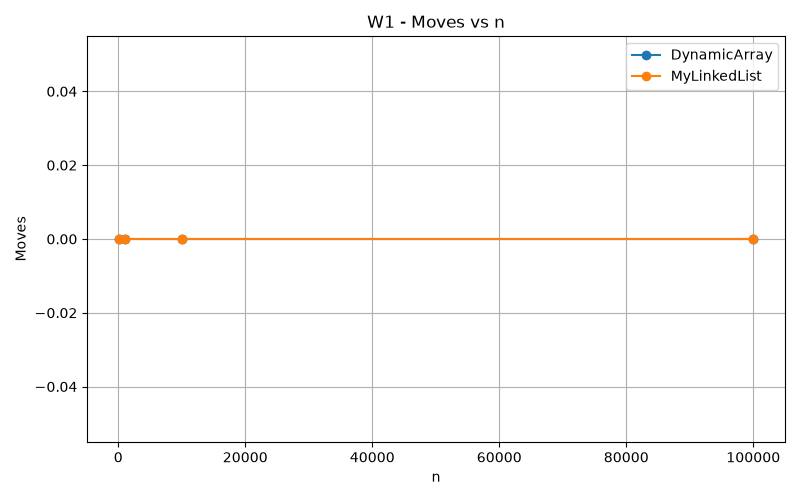

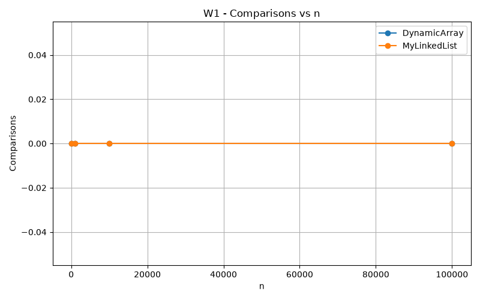

DynamicArray remains fast because an array provides direct indexed access. MyLinkedList becomes much slower as `n` increases because it must follow nodes from the head to reach a requested index.

### W2 – Search

W2 performs 1,000 `contains(x)` queries. Half of the searched values are present and half are absent.

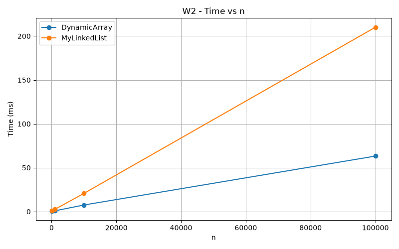

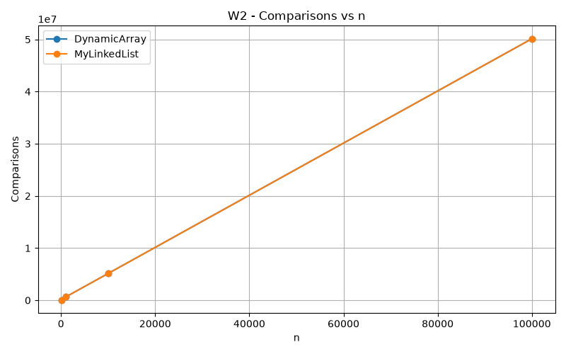
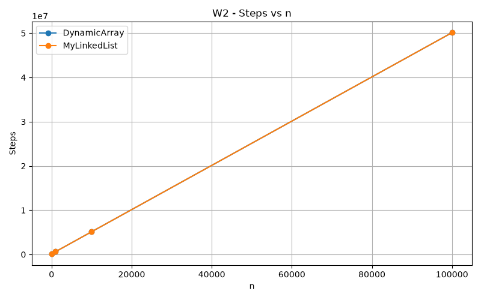

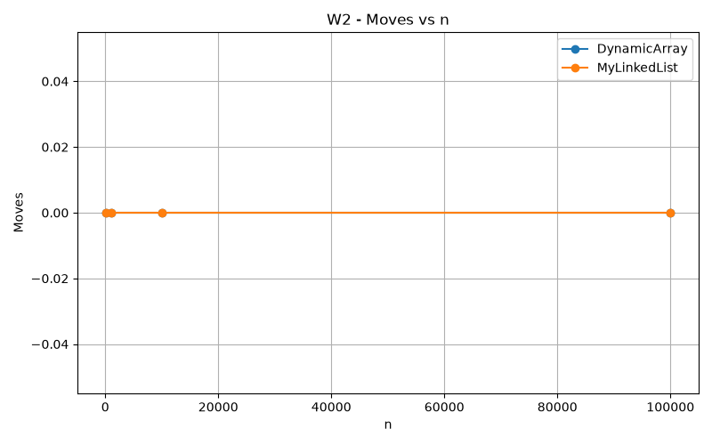

Both structures use linear search, so their operation counts grow with `n`. However, their real execution times can differ because the array stores primitive values in contiguous memory while list nodes are separate objects.

### W3 – Insert and Remove

W3 performs 1,000 insertions followed by 1,000 removals. It was tested at the head and at the middle of each structure.

#### Head

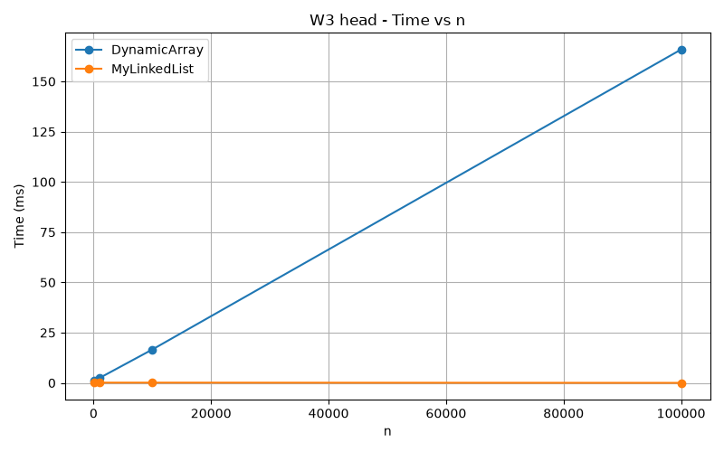

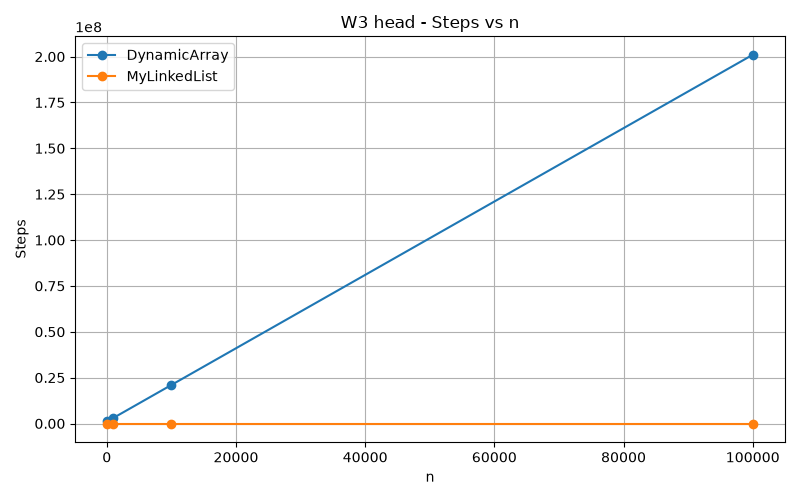

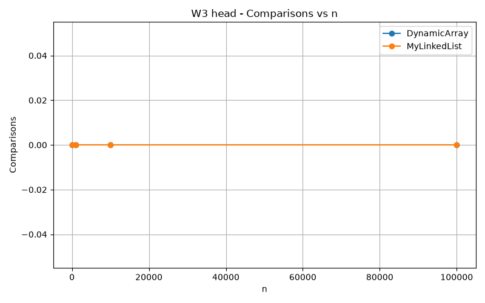

At the head, MyLinkedList performs operations efficiently because no traversal is required. DynamicArray must shift many elements during insertion and removal.

#### Middle

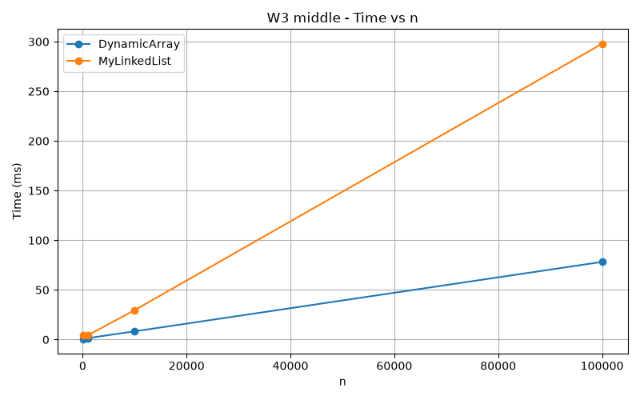

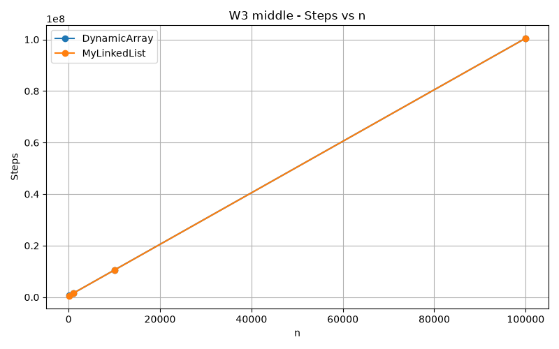

In the middle variant, MyLinkedList must traverse approximately half of the list to find the required position. DynamicArray also performs many shifts, but contiguous array storage gives it better cache locality.

### W4 – Priority Processing

W4 inserts `n` values into MinHeap and then repeatedly calls `extractMin()` until the heap is empty. The benchmark also checks that extracted values are in non-decreasing order.

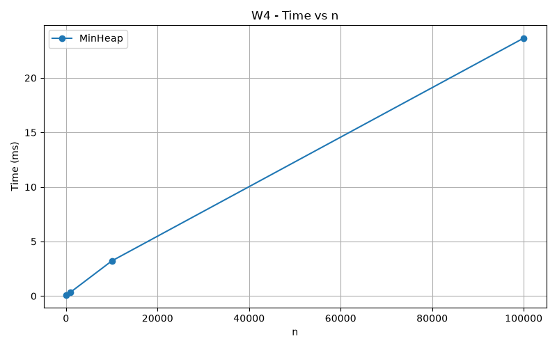

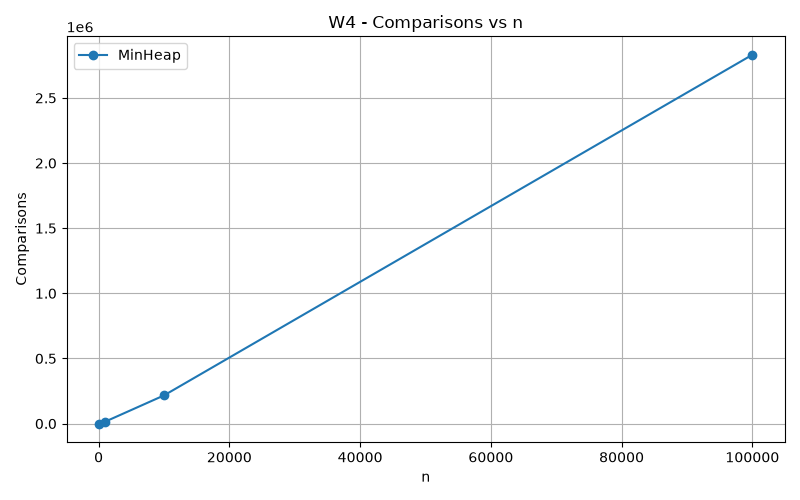

The results show the expected growth caused by heap operations. `extractMin()` may perform bubble-down through the height of the binary heap.

## 4. Discussion

DynamicArray is much faster than MyLinkedList for random access because an array can calculate the memory address of an element directly from its index.  
Its `get(index)` operation therefore takes constant time, while MyLinkedList must follow links from one node to another.  
DynamicArray also benefits from spatial locality because its primitive `int` values are stored next to each other in memory.  
When the CPU loads a cache line, several nearby array values can be loaded together and reused efficiently.  
Linked-list nodes may be located in different areas of memory, so traversing the list can cause more cache misses.  
This behavior is called pointer chasing because every node contains a reference that must be followed before the next node can be accessed.  
A linked list also has additional memory overhead because every element is stored inside a Node object containing both the value and a reference.  
These objects have object headers and must also be managed by the garbage collector.  
Therefore, two operations with similar asymptotic complexity can still have noticeably different real execution times.  
MyLinkedList is useful when insertions or removals are performed at the head because links can be updated without shifting many elements.  
However, insertion in the middle is not automatically fast because the list must first traverse to the required position.  
DynamicArray is a better choice when fast indexed access, iteration, and good cache locality are important.  
MinHeap is the better choice for priority processing because the minimum element is always available at the root and insertion and extraction require at most logarithmic restructuring.  
The benchmark results demonstrate that Big-O complexity is important, but memory layout and hardware behavior also affect practical performance.